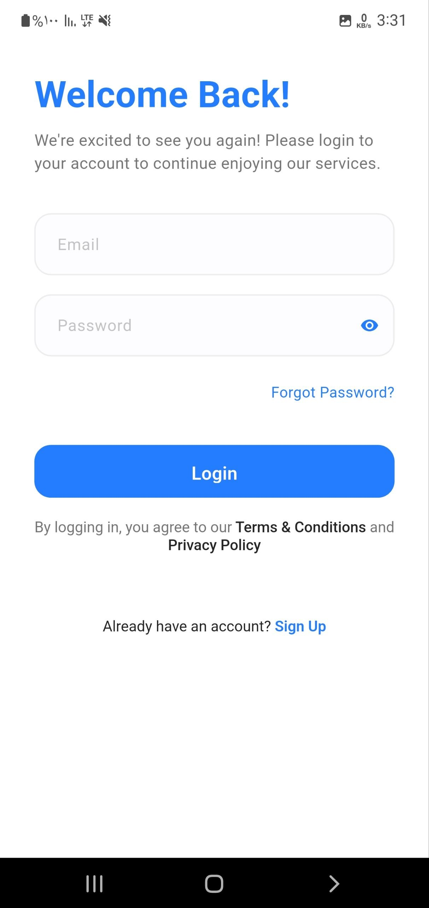
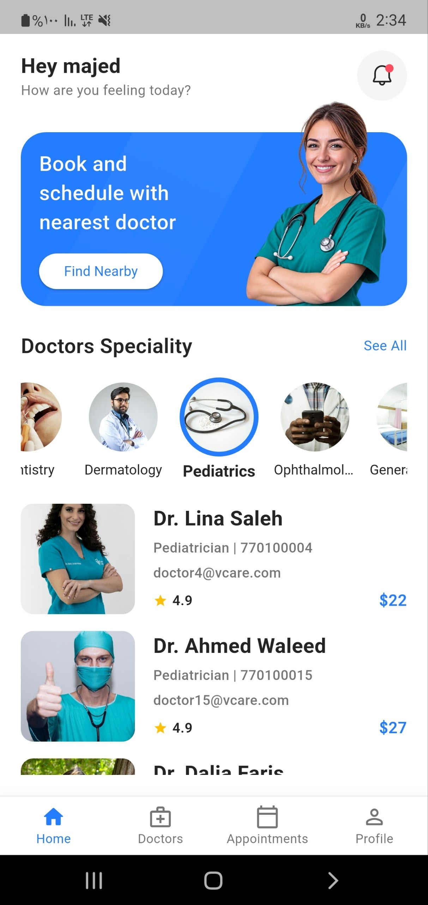
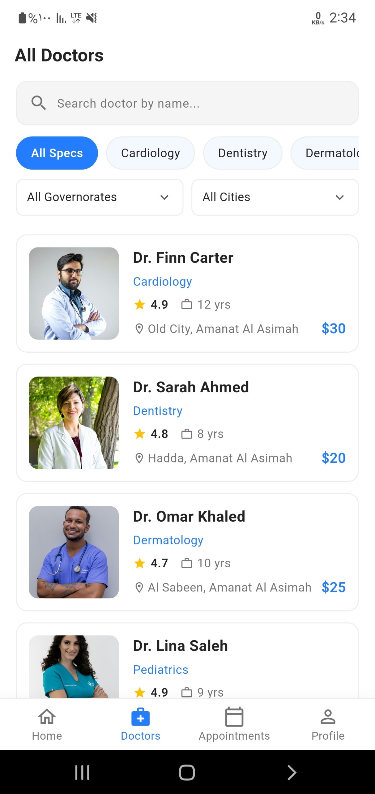
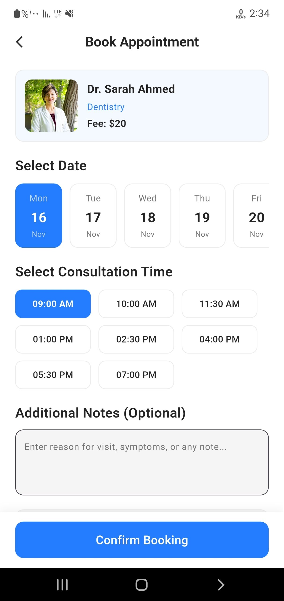
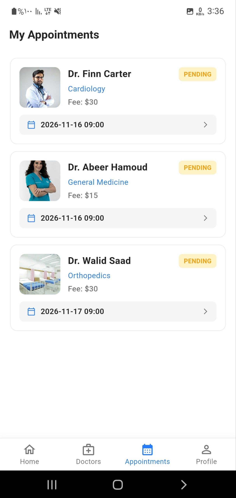
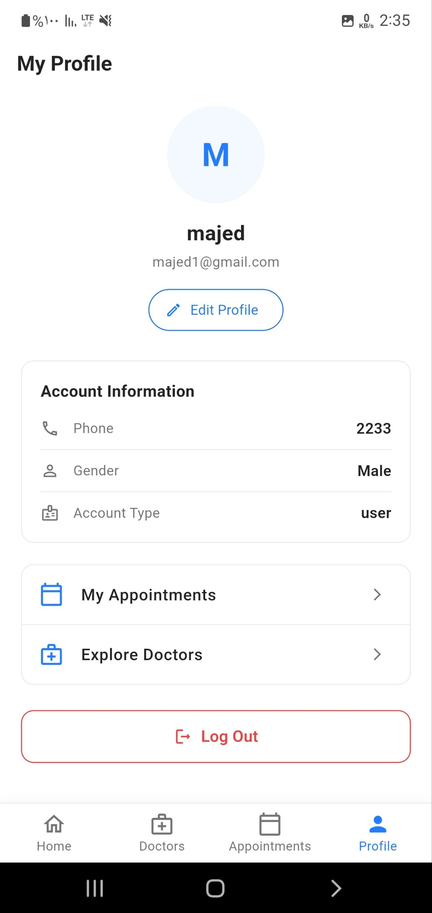
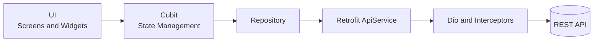
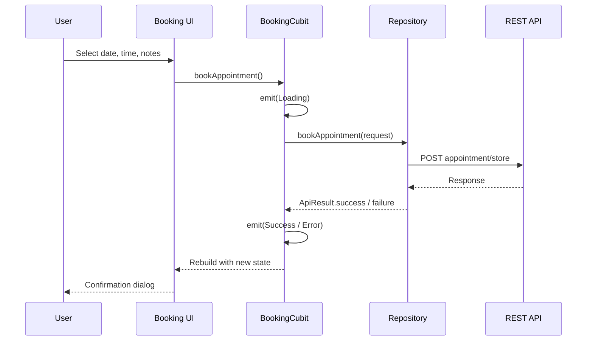

<div align="center">

# Doctor Booking App

**DocDoc** · Find the right doctor and book an appointment in a few taps.

A cross-platform Flutter application built with Clean Architecture, Cubit state management, a typed networking layer, multi-flavor builds, and an automated CI/CD pipeline.

<br/>


<br/><br/>


[Screenshots](#screenshots) · [Highlights](#highlights) · [Architecture](#architecture) · [API](#backend-api) · [Getting Started](#getting-started)

</div>

---

## Overview

Doctor Booking App lets patients create an account, explore doctors by specialty, narrow results by location, review a doctor's profile, and book an appointment, all from a single, fast, responsive interface.

The project is organized **feature-first**, with a strict separation between data, logic, and UI inside every feature. It is designed to be easy to read, easy to extend, and easy to test.

---

## Screenshots

| Onboarding | Login | Home |
|:---:|:---:|:---:|
|  |  |  |

| Doctors & Filters | Doctor Details | Booking |
|:---:|:---:|:---:|
|  |  |  |

| Appointments | Profile |
|:---:|:---:|
|  |  |

---

## Highlights

| Area | What was built |
|---|---|
| **Architecture** | Clean, feature-first structure. Each feature is split into `data`, `logic`, and `ui`, with the Repository pattern between the API and the Cubits. |
| **State management** | **Cubit** with **Freezed** immutable states. Every screen handles loading, success, error, and empty states explicitly. |
| **Networking** | **Retrofit + Dio** with centralized interceptors, a unified `ApiResult` wrapper, and structured error handling. |
| **Security** | Auth token kept in **secure storage**, attached automatically to every request, and cleared with automatic redirect to login on `401`. |
| **Environments** | **Flavors**: separate `development` and `production` builds with dedicated entry points. |
| **Delivery** | **GitHub Actions + Fastlane** distribute Android builds through **Firebase App Distribution**; iOS release builds are verified in CI. |
| **UX polish** | Shimmer loading, cached network images, debounced search, preserved tab state, and responsive sizing across devices. |

---

## Features

**Authentication and session**
- Sign up and login with token-based authentication
- One-time onboarding, persisted locally
- Automatic logout redirect when the session expires
- Secure logout that clears stored credentials

**Doctor discovery**
- Specialties and doctors on the home screen
- Search by name with a 400 ms debounce
- Filter by specialty, governorate, and city, with one-tap reset

**Booking**
- Detailed doctor profile with info, price, location, and contact
- Date and time selection, optional notes, and a booking summary
- Success confirmation and immediate refresh of the appointments list

**Appointments and profile**
- Appointments list with status, details bottom sheet, empty state, and retry on failure
- View and edit personal information

**Navigation**
- Bottom navigation built on `IndexedStack` so each tab keeps its state

---

## Architecture



### Request lifecycle: booking an appointment



### Project structure

```text
lib/
├── main_development.dart       # Development flavor entry point
├── main_production.dart        # Production flavor entry point
├── doc_app.dart                # App root: theme, providers, routing
│── firebase_options.dart       # Firebase Development
├── core/
│   ├── di/                     # GetIt dependency injection
│   ├── helpers/                # Constants, shared prefs, extensions, regex, spacing
│   ├── networking/             # Dio factory, ApiService, ApiResult, error handling
│   ├── routing/                # Named routes and AppRouter
│   ├── theming/                # Colors, text styles, theme
│   └── widgets/                # Reusable widgets
│
└── features/
    ├── onboarding/     ├── login/          ├── sign_up/
    ├── main_layout/    ├── home/           ├── doctors/
    ├── doctor_details/ ├── booking/        ├── appointments/
    └── profile/
        ├── data/       # apis, models, repos
        ├── logic/      # Cubit and Freezed states
        └── ui/         # screens and widgets
```

---

## Engineering Decisions

- **Cubit over heavier patterns:** simple, explicit state transitions with minimal boilerplate, while staying fully testable.
- **Freezed states:** immutable, exhaustive, and safe to pattern-match in the UI.
- **Retrofit + Dio:** API contracts are declared once with annotations, and cross-cutting concerns (auth header, logging, `401` handling) live in a single interceptor setup.
- **GetIt:** services and repositories are registered in one place, keeping features decoupled and easy to swap or mock.
- **Secure storage for tokens:** credentials are separated from regular preferences, which only hold non-sensitive flags such as onboarding status.
- **Flavors:** environment-specific configuration without code changes, ready for staging or additional targets.

---

## Backend API

The app consumes a REST API with mock data:

```text
https://vcare-live-mock-api.onrender.com/api/
```

> The first request may take a few seconds if the server has been idle.

Authenticated requests carry `Authorization: Bearer <token>`, injected automatically by the Dio interceptor.

| Method | Endpoint | Description |
|---|---|---|
| `POST` | `auth/register` | Create a new account |
| `POST` | `auth/login` | Authenticate and receive a token |
| `POST` | `auth/logout` | Log the user out on the server |
| `GET` | `home/index` | Home data, used to load specialties |
| `GET` | `specialization/index` | List specialties |
| `GET` | `governrate/index` | List governorates (filters) |
| `GET` | `city/index` | List cities (filters) |
| `GET` | `doctor/index` | List all doctors |
| `GET` | `doctor/doctor-search?name=` | Search doctors by name |
| `GET` | `doctor/doctor-filter` | Filter by `specialization`, `governrate`, `city` |
| `GET` | `doctor/show/{id}` | Doctor details |
| `POST` | `appointment/store` | Book an appointment |
| `GET` | `appointment/index` | List the user's appointments |
| `GET` | `user/profile` | Get the current user's profile |
| `POST` | `user/update` | Update profile information |

Base URL and paths are defined in `lib/core/networking/api_constants.dart`.

---

## Flavors

| Flavor | Entry point | Run command |
|---|---|---|
| `development` | `lib/main_development.dart` | `flutter run --flavor development -t lib/main_development.dart` |
| `production` | `lib/main_production.dart` | `flutter run --flavor production -t lib/main_production.dart` |

---

## CI/CD

- **Android:** GitHub Actions runs Fastlane and distributes builds through Firebase App Distribution.
- **iOS:** release build verification (no code signing) in GitHub Actions.
- **Reproducible builds:** Flutter version pinned in CI (`3.32.6`).

---

## Tech Stack

| Area | Tools |
|---|---|
| Framework | Flutter, Dart 3 |
| State management | `flutter_bloc` (Cubit) |
| Networking | `dio`, `retrofit`, `pretty_dio_logger` |
| Models and codegen | `freezed`, `json_serializable`, `build_runner` |
| Dependency injection | `get_it` |
| Local storage | `flutter_secure_storage`, `shared_preferences` |
| UI | `flutter_screenutil`, `flutter_svg`, `cached_network_image`, `shimmer` |
| Utilities | `intl`, `flutter_native_splash`, `flutter_launcher_icons` |
| DevOps | GitHub Actions, Fastlane, Firebase App Distribution |

---

## Getting Started

**Prerequisites:** Flutter (stable, Dart `^3.8.1`) and an internet connection.

```bash
# Clone the repository
git clone https://github.com/majed-edu/doctor_booking_app.git
cd doctor_booking_app

# Install dependencies
flutter pub get

# Generate code (Freezed, JSON, Retrofit)
dart run build_runner build --delete-conflicting-outputs

# Run the development flavor
flutter run --flavor development -t lib/main_development.dart
```

**Release build (Android):**

```bash
flutter build apk --release --flavor production -t lib/main_production.dart
```

No `.env` file or API keys are required to run the app.

---

<div align="center">

Built by [Majed](https://github.com/majed-edu)

If you find this project useful, consider giving it a star.

</div>
